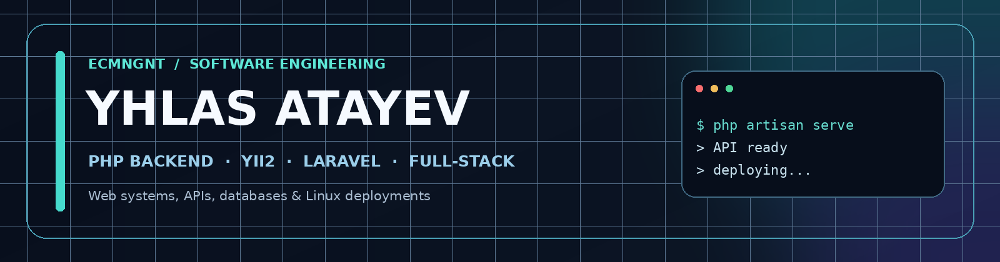

<!-- Personal GitHub profile README for github.com/ecmngnt -->

  

  <strong>PHP Backend Developer · Yii2 · Laravel · Web Systems</strong> 
  Based in Germany · Open to qualified software engineering opportunities

  
  
  

## About me

I'm **Yhlas Atayev**, a web developer with **3–5 years of hands-on, project-based experience** building and maintaining backend systems, content platforms, and operational web applications.

I work primarily with **PHP, Yii2, and Laravel**. I also build frontend functionality with JavaScript and Vue.js, integrate databases and APIs, and deploy applications on Linux servers. My background includes independently written systems as well as collaborative, AI-assisted projects; I distinguish these contributions clearly.

I'm currently in **Germany** and interested in **PHP Backend / Full-Stack Developer** roles.

## Technical toolkit

**Backend & APIs**

**Frontend & data**

**Infrastructure & delivery**

## Selected engineering work

> These are **private project case studies**, not public source-code repositories. Descriptions focus on technical work rather than client-sensitive details.

### 01 · Transport & ticketing platform — PHP / Yii2

An operational application with route and trip management, seat and ticket workflows, payment-related modules, REST endpoints, SMS integration, and administrator permissions.

**Engineering focus:** backend business logic, relational data models, integrations, Yii2 MVC architecture, and application maintenance.

### 02 · Transport operations dashboard — PHP / Laravel 11

A Laravel-based administration system for routes, stops, vehicles, events, and seat allocation. It includes request validation, permission-based administration, Eloquent relationships, and transactional workflows.

**Engineering focus:** Laravel backend architecture, reusable components, validation, database transactions, and role-based access control.

### 03 · Media & content platform — PHP / Yii

Web platform and content-management work involving PHP backend functionality, custom content workflows, and ongoing maintenance in a production-oriented codebase.

**Engineering focus:** backend development, content-management features, database-driven pages, and collaboration with content/SEO teams.

<strong>AI-assisted experimentation</strong>

 

I also experiment with AI-assisted application development and automation. For these projects, I distinguish AI-generated implementation from the engineering decisions, testing, integration, and deployment work I personally performed.

## How I work

- Start from the business process and data model, then design maintainable backend logic.
- Prefer explicit validation, understandable permissions, and predictable database operations.
- Handle practical deployment tasks across Ubuntu, Nginx/Apache, Docker, and relational databases.
- Treat older systems as real engineering work: debugging, maintenance, safe changes, and migrations matter.

## Let's connect

If you're hiring for **PHP Backend, Yii2, Laravel, or Full-Stack** roles in Germany, I'd be glad to discuss my experience and share appropriate project details privately.

**Email:** [ecmngnt@gmail.com](mailto:ecmngnt@gmail.com) · **GitHub:** [@ecmngnt](https://github.com/ecmngnt)

---

Project names and source code remain private unless the respective owners approve disclosure. Descriptions are intentionally concise and may be expanded with permission.
